<picture>
  <source media="(prefers-color-scheme: dark)" srcset="./assets/banner-dark.svg">
  
</picture>

I work on two things that turn out to need the same discipline: computer vision for embryo and chromosome imaging at **ICIP Lab (Saigon University)**, and agentic LLM systems that people actually use. In both, the rule is the same: measure it, and make every claim traceable to its evidence.

<table>
<tr>
<td width="50%" valign="top">

**Research**

Oriented object detection, self-supervised encoders, and constraint-aware post-processing for medical imaging. Work with Hung Vuong Hospital, published in a Scopus Q1 journal.

</td>
<td width="50%" valign="top">

**Engineering**

Agentic RAG with fine-tuned retrieval, human-in-the-loop procurement agents, and the serving layer underneath: vLLM, Triton, PostgreSQL, Terraform. Two systems are live.

</td>
</tr>
</table>

  
  
  
  
  

<picture>
  <source media="(prefers-color-scheme: dark)" srcset="./assets/divider-dark.svg">
  
</picture>

## Featured work

### LitMesh

A research assistant for scientific papers that retrieves evidence, synthesizes grounded answers, and attaches verifiable citations to every claim. Source is private; the system is live at [litmesh.n1giahuy.com](https://litmesh.n1giahuy.com/).

<picture>
  <source media="(prefers-color-scheme: dark)" srcset="./assets/litmesh-dark.svg">
  
</picture>

The interesting engineering is in the retrieval layer. The agent plans multi-step retrieval and expands context through document-structure links instead of firing more semantic queries. Fine-tuning Qwen3-Embedding-0.6B with LoRA and InfoNCE on QASPER lifted NDCG@5 from 0.477 to 0.676. A zero-shot reranker made things worse (NDCG@5 dropped to 0.563), so I fine-tuned bge-reranker-v2-m3 on mined hard negatives and recovered 0.716 NDCG@5 and 0.814 MRR. On the QASPER dev set the system reaches 62.63 Evidence F1, about twice the original paper's LED-large baseline of 31.25.

### PurchaseFlow

Procurement automation that turns a chat request into a supplier-acknowledged purchase order. The agent only drafts; approvals, RFQs, and orders require a person or a system event. Source is private; the system is live at [erp.n1giahuy.com](https://erp.n1giahuy.com/).

<picture>
  <source media="(prefers-color-scheme: dark)" srcset="./assets/purchaseflow-dark.svg">
  
</picture>

Multi-day RFQ workflows run on a PostgreSQL state machine with a SKIP LOCKED scheduler that closes deadlines, flags silent suppliers, and escalates stalled decisions. Every state change sends its email exactly once through a transactional outbox and idempotent Resend delivery. Department-scoped RBAC lives in one authorization module shared by the API, the UI, and the agent's 16 role-scoped tools. The whole flow takes five human clicks.

<picture>
  <source media="(prefers-color-scheme: dark)" srcset="./assets/divider-dark.svg">
  
</picture>

## Research

<picture>
  <source media="(prefers-color-scheme: dark)" srcset="./assets/research-dark.svg">
  
</picture>

**Deep Learning-Based Imaging Informatics for Automated Detection of Cytoplasmic Strings in Embryo Time-Lapse Microscopy.** Journal of Imaging Informatics in Medicine, Scopus Q1. [doi:10.1007/s10278-026-02269-4](https://doi.org/10.1007/s10278-026-02269-4)

## Open source

| Repository | What it does | Numbers |
| --- | --- | --- |
| [industrial-inspection-platform](https://github.com/n1giahuy/industrial-inspection-platform) | Unsupervised defect detection for manufacturing (EfficientAD), with a Streamlit UI, FastAPI backend, and a Prometheus + Grafana monitoring stack, all Dockerized | image AUROC 0.97, pixel AUROC 0.81, about 10 ms per image on GPU |

<picture>
  <source media="(prefers-color-scheme: dark)" srcset="./assets/divider-dark.svg">
  
</picture>

## Stack

| | |
| --- | --- |
| **Computer vision** | PyTorch, Hugging Face Transformers and PEFT, Ultralytics YOLO (incl. OBB), OpenCV, scikit-learn, CVAT. Classification, detection, segmentation, anomaly detection; supervised, self-supervised, and unsupervised learning |
| **LLMs and agents** | LlamaIndex, Google ADK, Gemini on Vertex AI, RAG, LoRA fine-tuning, Qdrant, pgvector, DeepEval |
| **Serving and MLOps** | vLLM, NVIDIA Triton, ONNX Runtime, Docker, GitHub Actions, Prometheus, Grafana |
| **Backend and cloud** | FastAPI, PostgreSQL, Redis, SQLAlchemy, GCP (Cloud Run, Firestore), Firebase, Terraform, Cloudflare, Nginx |

  
  
  
  
  
  
  
  
  
  
  
  
  
  
  
  
  

## Competitions and community

- Top 50, AI Riser Vietnam 2026 by Google Developer Groups, out of more than 750 AI projects nationwide
- Top 7 finalist, AI and Data Science track, Skilio SEA TechSkills Challenge 2025
- Google Developer Group on Campus Lead at Saigon University, since 10/2025
- Information Technology, Saigon University. GPA 3.49, Dean's Merit Scholarship for four semesters

<picture>
  <source media="(prefers-color-scheme: dark)" srcset="./assets/footer-dark.svg">
  
</picture>
